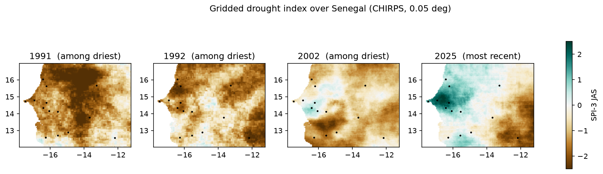
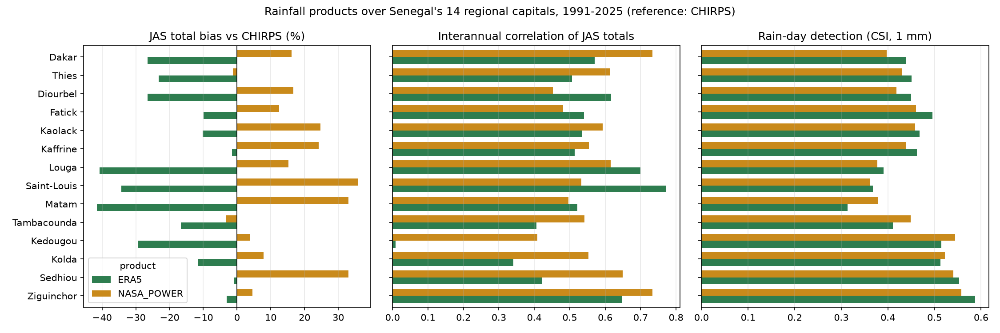

# Senegal Agro-Climate Monitor

Rainy-season monitoring for Senegal's agriculture, 1991-2025: data ingestion and quality control of
three rainfall products, a benchmark between them, agro-climatic indicators for the 14 regional
capitals, gridded drought maps, a CNN forecasting experiment and a decision-support dashboard.

Almost all of Senegal's crops are rainfed, so the questions a farmer or an extension service asks are
climatic ones: when does the season start, how long does it last, how long are the dry spells, and is
this year a drought? This project builds the data chain that answers them, from public sources only.



## Data

| Product | What it is | Access | Use here |
|---|---|---|---|
| **CHIRPS v2.0** | Satellite rainfall blended with rain gauges, 0.05 deg | CHC monthly GeoTIFFs; ClimateSERV API (daily, points) | Reference product, daily indicators, gridded maps |
| **ERA5** | ECMWF reanalysis | Open-Meteo archive API | Benchmarked against CHIRPS |
| **NASA POWER** | MERRA-2 based, bias-corrected, agro-climatology community | NASA POWER API | Benchmarked against CHIRPS |

The monthly CHIRPS maps are streamed: each African GeoTIFF is downloaded in memory, cropped to
Senegal and discarded. The full 35-year Senegal cube is 17 MB.

## Pipeline

```
src/ingest_chirps.py     monthly CHIRPS cube over Senegal (420 months x 100 x 133 cells)
src/ingest_points.py     daily CHIRPS, ERA5, NASA POWER at the 14 regional capitals (12,784 days each)
src/quality_control.py   missing dates, duplicates, fill values, physical range checks -> qc_report.csv
src/benchmark.py         ERA5 and NASA POWER vs CHIRPS: daily, monthly and seasonal metrics
src/indicators.py        onset, cessation, season length, dry spells, SPI-3, trends, drought maps
notebooks/cnn_rainfall_forecast.ipynb   CNN forecast of next-month rainfall anomalies (Colab)
app/streamlit_app.py     decision-support dashboard
```

```bash
pip install -r requirements.txt
python src/ingest_chirps.py && python src/ingest_points.py
python src/quality_control.py && python src/benchmark.py && python src/indicators.py
streamlit run app/streamlit_app.py
```

## Results

**Quality control caught a real error.** The CHIRPS point for the city of Saint-Louis fell on a sea
pixel and returned the fill value for all 12,784 days. The site was moved 8 km inland, into the
agricultural delta. Nine NASA POWER daily values above 250 mm were also flagged and set to missing.

**The rainfall gradient is steep.** Average July-September rainfall goes from 228 mm at Saint-Louis to
1,034 mm at Ziguinchor. The season starts around 3 June at Kedougou and around 12 August at Saint-Louis.
At Saint-Louis, the onset criterion is not met in 10 of the 35 years: at the arid northern edge, a
"season" in the agronomic sense does not occur every year.

**Rainfall has increased since 1991.** July-September rainfall shows a significant upward trend
(Mann-Kendall, p < 0.05) at 9 of the 14 capitals, with a median Theil-Sen slope of +40 mm per decade
across all sites. The season has also lengthened significantly at Dakar, Kaolack and Kaffrine, by 7 to
11 days per decade. No site shows a significant trend in onset date. This is consistent with the
documented recovery of Sahel rainfall after the droughts of the 1970s-1980s.

**Drought years stand out on the maps.** More than 40 % of the territory was in drought (SPI-3 < -1)
in 1991 (71 %), 1992 (60 %), 1996, 2002, 2014 and 2019. 2002 and 2014 match the poor seasons reported
for Senegal in those years.

**Neither ERA5 nor NASA POWER can replace CHIRPS for drought monitoring.**

| vs CHIRPS, 14 sites | ERA5 | NASA POWER |
|---|---|---|
| Bias of July-September totals | -20 % (down to -42 % at Matam) | +16 % (up to +36 % at Saint-Louis) |
| Rain days detected (POD, 1 mm) | 0.64 | 0.87 |
| False alarm ratio | 0.38 | 0.52 |
| Interannual correlation of JAS totals | 0.51 | 0.57 |

Monthly totals correlate well (r = 0.87 for both), so the seasonal cycle is right. But the year-to-year
signal, which is what a drought index depends on, agrees only moderately; for ERA5 at Kedougou it is
essentially uncorrelated (r = 0.01). NASA POWER detects most rain days but adds many false ones.
These products are useful for temperature and for gap-filling, but drought monitoring should rely on
gauge-blended rainfall.



**CNN forecast.** See the notebook. The question is whether a convolutional network using the last three
monthly rainfall maps beats climatology and persistence for next-month anomalies. The test set
(2019-2025) is never used during training or model selection, and the result is reported as it comes.

## Methods

- **Onset:** Sivakumar (1988), the standard definition in the Sahel: first day after 1 May with at
  least 20 mm over 3 days, not followed by a dry spell longer than 7 days in the next 30 days.
- **Cessation:** simple soil water balance (100 mm capacity, 5 mm/day evapotranspiration): first day
  after 1 September, and after onset, when the store is empty.
- **SPI-3 (July-September):** gamma distribution fitted on the 1991-2020 normal, with the zero-rain
  probability handled explicitly (McKee et al., 1993).
- **Trends:** Mann-Kendall test and Theil-Sen slope.
- **Benchmark:** POD, FAR and CSI for rain-day detection at 1 mm; bias, RMSE and Pearson r for May-October
  monthly totals; bias and correlation of July-September totals across years.

## Limitations

- **No station data.** CHIRPS is the reference because it blends rain gauges, but it is not ground
  truth. The benchmark is an inter-product comparison; validating against national station data from
  ANACIM would be the next step.
- **Sites, not regions.** Each region is represented by its capital. Regional averages would be better
  computed from the gridded data.
- **Fixed thresholds.** The onset and cessation parameters are the standard Sahelian ones. They are not
  calibrated per crop or per soil.

## Author

Mariem Dia, Dakar.
